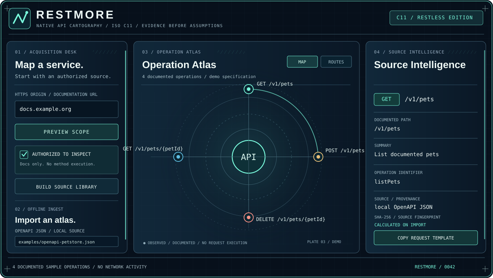

# RESTMORE / ABOUT

## MAP THE UNSEEN.

**RESTMORE is a native C11 atlas for documented APIs.** It turns authorized HTTPS documentation and local OpenAPI 3 JSON files into an explorable map of routes, methods and operation details, with source references and SHA-256 fingerprints.

Not a fuzzer. Not an endpoint-guessing engine. A cartographer for evidence.

### The pitch

> **Know what is documented. Know where it came from.**

APIs grow faster than their diagrams. RESTMORE converts the scattered source material into a reusable visual library. Import a specification, inspect the orbital operation atlas, verify an operation's provenance and export formats for your next tool.

### What's different?

Documentation remains the source of truth for the atlas. RESTMORE does not equate a plausible URL with a real endpoint and does not execute the methods it finds. Network discovery must be both explicitly enabled and authorized.

### Intended audience

Developers, platform teams, API maintainers, security reviewers and technical investigators working on systems they are permitted to inspect.

### Technology and honest status

Native implementation: **ISO C11 + CMake + optional raylib GUI + libcurl for authorized desktop HTTPS documentation discovery.** Windows, Linux and macOS alpha desktop downloads exist. Android ARM64 has an **offline, CI-debug-signed test APK**, with physical-device verification outstanding. The iOS C core builds in CI; an installable iOS app is not yet available.

The website is a design showcase with **synthetic sample routes**, not a hosted scanner.

**Read:** [illustrated field guide](docs/field-guide.html) · [product description](docs/PRODUCT.md) · [website](https://bspippi1337.github.io/restmore/) · [releases](https://github.com/bspippi1337/restmore/releases/tag/v0.1.0-alpha.4)

---

### GitHub sidebar / About metadata

The repository's GitHub sidebar is configured under **Settings → General** or by clicking the gear beside *About*. GitHub's connected integration currently permits file edits but does not expose repository-metadata edits. Use these fields in the sidebar:

**Description (copy-ready):**

`MAP THE UNSEEN. Native C11 API cartography: turn authorized OpenAPI docs into a visual, evidence-backed atlas of routes and provenance. Not a fuzzer.`

**Website:** `https://bspippi1337.github.io/restmore/`

**Topics:** `c`, `c11`, `api`, `openapi`, `api-documentation`, `api-mapping`, `raylib`, `libcurl`, `cross-platform`, `developer-tools`

RESTMORE / RESTLESS EDITION / 0042
