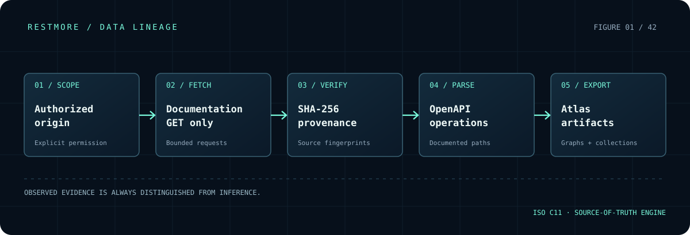

<div align="center">

# R / M   RESTMORE

### MAP THE UNSEEN.

**Native API cartography · ISO C11 · Evidence before assumptions**

[Website and interactive design preview](https://bspippi1337.github.io/restmore/) · [Architecture](docs/ARCHITECTURE.md) · [Build guide](docs/BUILD.md) · [Source](https://github.com/bspippi1337/restmore)

  

</div>

---

## The mission

RESTMORE exists to turn **authorized API documentation** into a structured, auditable map: documented paths, HTTP methods, sources, provenance hashes, and formats designed for further inspection.

This is a **documentation atlas**, **not** a fuzzer or an aggressive endpoint enumerator. It does not execute the API operations it discovers.

The application's implementation is written in **C11**. CMake handles native builds. libcurl supplies HTTPS connectivity, and raylib provides the optional graphical interface. The browser-only GitHub Pages site is a product showcase with an illustrative interactive topology, not the scanner.



## The pipeline

```text
         EXPLICIT TARGET + AUTHORIZATION
                        |
                   NORMALIZE URL
                        |
                 SCOPE / DNS CHECKS
                        |
          ROBOTS RULES + REQUEST LIMITS
                        |
              GET DOCUMENTATION ONLY
                        |
           DOCUMENT SHA-256 + SOURCE URL
                        |
              OPENAPI JSON EXTRACTION
                        |
                 DOCUMENTED OPERATIONS
                        |
                EVIDENCE-BASED ATLAS
                        |
          +-------------+-------------+
          |             |             |
        OpenAPI        Postman       Graph
                                     SVG / Mermaid
```

The source reference for each discovered operation matters as much as the operation itself.

## Native build

**Prerequisites:** CMake 3.21+, a working C11 compiler, libcurl development package, and optional raylib source acquisition for GUI targets.

```sh
git clone https://github.com/bspippi1337/restmore.git
cd restmore
cmake -S . -B build -DCMAKE_BUILD_TYPE=Release
cmake --build build --config Release
ctest --test-dir build --output-on-failure
```

The CLI executable is `restmore-cli` (or `restmore-cli.exe` on Windows).

### Preview and import

```sh
# Safe preview: no network execution by default
./build/restmore-cli docs.example.org

# Import a local OpenAPI 3 JSON document
./build/restmore-cli --import example-openapi.json --out atlas

# Crawl only documentation you are authorized to inspect
./build/restmore-cli https://docs.example.org/reference --execute --authorized --out atlas
```

For documented options and packaging constraints see **[BUILD.md](docs/BUILD.md)**. Run `restmore-cli --help` to check options supported by your checkout.

### Native GUI

```sh
cmake -S . -B build-gui -DRESTMORE_GUI=ON -DCMAKE_BUILD_TYPE=Release
cmake --build build-gui --config Release
```

The optional GUI uses raylib **in C**, with a shared application core. Android and iOS require the usual platform-specific SDK/NDK, runtime dependencies and packaging/signing. Cross-platform source support does **not** imply tested or published binary releases for every platform.

## Safety and scope

RESTMORE deliberately requires **both** `--execute` and `--authorized` before initiating discovery requests. The implementation is designed around limited page counts, depth bounds, request delays, robots guidance, public-network restrictions, and conservative same-origin discovery.

**Do not interpret these guardrails as a guarantee of complete isolation or production-ready security.** Validate network boundaries and crawler behavior in your own environment before using against sensitive systems. No arbitrary method probing, parameter fuzzing, or credential attacks are intended.

## Project organization

| Area | Role |
|:--|:--|
| `include/restmore/` | Public C interfaces and data structures |
| `src/core.c` | Input normalization and local core logic |
| `src/network.c` | Bounded HTTPS documentation discovery |
| `src/json.c`, `src/catalog.c` | Evidence and OpenAPI ingestion |
| `src/sha256.c` | Document content fingerprints |
| `src/exports.c` | Atlas format exports |
| `src/cli.c` | Native command-line application |
| `src/gui.c` | Optional native raylib visualization |
| `tests/` | C regression tests |
| `docs/` | Product site, diagrams and engineering docs |
| `.github/workflows/` | CI, builds, site deployment |

## Engineering priorities

1. **Verifiable behavior:** test normalization, hashing, JSON imports and exports with fixtures; add integration tests with controlled HTTP fixtures.
2. **Documented capability:** distinguish implemented features from target architecture. No invented releases or unsupported platform claims.
3. **Safe discovery:** prevent scope expansion, accidental private-network access, redirects outside the intended origin and unbounded traffic.
4. **Consistent UI:** a shared visual grammar across native raylib, sample topology, README, and GitHub Pages.
5. **Release discipline:** publish binaries only when each target has passed build, runtime and distribution checks.

## Status

This is an **early-stage implementation**. C11 modules, a native GUI source, tests, and a GitHub Pages visual prototype exist in the repository. The website preview uses synthetic endpoints, and build/deployment success should be confirmed via GitHub Actions before treating release targets as verified.

> **RESTMORE** · An atlas, not a fuzzer. · RESTLESS / 42

---
MIT license, subject to the repository's LICENSE file.
