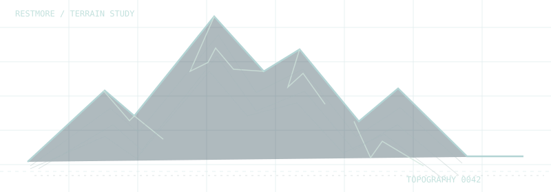
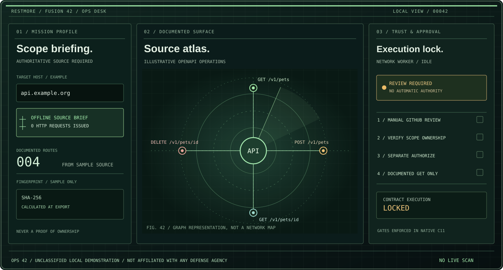
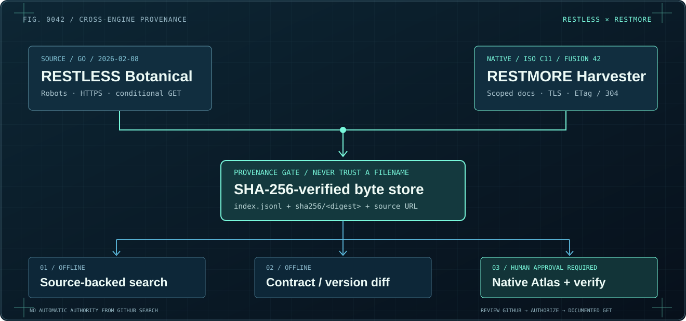
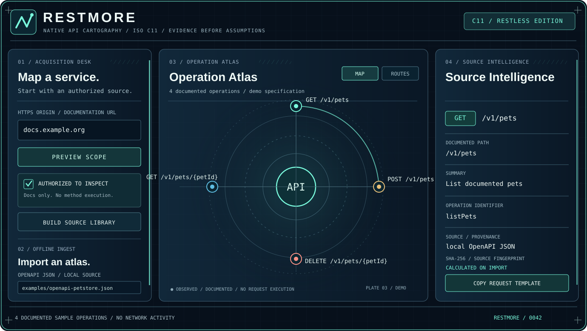
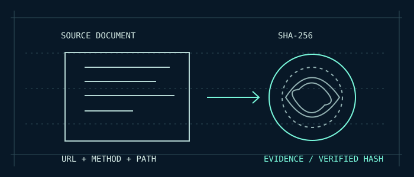

<div align="center">


# RESTMORE
### MAP THE UNSEEN.

**THE API IS TERRITORY. THE DOCUMENTATION IS OUR STARTING POINT.**

*Native API cartography. ISO C11. Evidence before assumptions.*

[**OPS 42 MISSION CONTROL**](https://bspippi1337.github.io/restmore/ops-42.html) &nbsp; / &nbsp; [**EXPLORE THE WEBSITE**](https://bspippi1337.github.io/restmore/) &nbsp; / &nbsp; [**DOWNLOAD ALPHA 7**](https://github.com/bspippi1337/restmore/releases/tag/v0.1.0-alpha.7) &nbsp; / &nbsp; [**ILLUSTRATED FIELD GUIDE**](docs/field-guide.html)

 &nbsp;  &nbsp; 



</div>


## OPS 42 / Operational Mission Control



**A source-backed operational briefing desk, not a network attack console.** The native GUI now uses a restrained olive/phosphor-green field-console design with amber approval locks. An operator can export a deterministic **offline mission brief** from the existing RESTMORE or RESTLESS atlas, including documented routes, method inventory, SHA-256 atlas fingerprint and explicit `REVIEW_REQUIRED` state.

The authorization workflow is unchanged: entering a domain does not grant access, GitHub search is a manual attribution step, and separate acknowledgment plus **AUTHORIZE** are required before eligible documented GET checks.

[**ENTER OPS 42 MISSION CONTROL**](docs/ops-42.html) · [**OPERATIONAL FIELD MANUAL**](docs/OPS-42.md) · [**REVIEW C11 BRIEF WRITER**](src/ops_brief.c) · [**CI PROOF**](https://github.com/bspippi1337/restmore/actions/workflows/ops-42.yml)

Build without network access and generate an inspectable evidence brief:

    cmake -S . -B build-ops -DRESTMORE_NETWORK=OFF -DRESTMORE_TESTS=ON
    cmake --build build-ops --config Release
    ./build-ops/restmore-cli --import examples/openapi-petstore.json --ops-brief --out evidence

Output: evidence/ops-brief.json, with no network requests, no inferred authorization, and no invented security findings.

---

## Fusion 42 / RESTLESS × RESTMORE  <small>native C11 integration</small>

> **Experimental C11 integration, separately reviewed and tested.**
> Integration does not imply production certification or automatic authority to inspect a target.



**The original RESTLESS began 8 February 2026** as a one-domain, Go CLI API discovery engine. Its later Botanical harvester brought content-addressed SHA-256 evidence, JSONL provenance, ETag revalidation, source-backed search and contract diff. Fusion 42 ports the best interoperable parts to a standalone native C11 engine and GUI, without introducing speculative endpoint probing.

**Implemented Fusion 42 capabilities:** authenticated-scope documentation GET crawler with RESTLESS-compatible archives; SHA-verified local Botanical import; ETag/Last-Modified + HTTP 304 reuse with cache-integrity check; source-backed route search and contract diff; native GUI archive import; configurable documentation scope and 5/25/full-atlas documented GET verification behind GitHub review + separate AUTHORIZE.

**Live target execution is never triggered by archive import, search or diff.** The controlled TLS integration suite exercises real HTTP 200/304, SHA-256 tamper rejection, robots denial, rate limits and certificate validation without contacting public hosts. Source identity and permission must be reviewed independently. Robots, TLS, rate policy and same-host validation remain enforced.

[**SEE THE ART-DIRECTED FUSION 42 CASE STUDY**](docs/fusion-42.html) · [**TECHNICAL DESIGN + ORIGINAL RESTLESS HISTORY**](docs/FUSION-42.md) · [**CI BUILD & VISUAL TESTS**](https://github.com/bspippi1337/restmore/actions/workflows/fusion-42.yml)

Offline demonstration using an existing RESTLESS Botanical archive:

    cmake -S . -B build-fusion -DRESTMORE_NETWORK=OFF -DRESTMORE_TESTS=ON
    cmake --build build-fusion --config Release
    ./build-fusion/restmore-cli --fusion-import .restless/botanical --out fusion-atlas
    ./build-fusion/restmore-cli --fusion-import .restless/botanical --fusion-search "list pets" --out fusion-atlas

---

## Meet your cartographer.

APIs are sprawling territories. Their documentation is a partial map, often spread across pages, specifications and disconnected route lists.

**RESTMORE turns documentation you are authorized to inspect into a structured, traceable atlas.** It identifies *documented* paths and HTTP operations, maps their relationships, preserves their sources and builds exports you can actually use.

It does not guess endpoints or bombard hosts. No API operation is executed by default. The separate **Verification Mode** checks up to five explicitly authorized, documented GET responses, never mutating methods. **An atlas, not a fuzzer.**

<p align="center"></p>

*PLATE 03 / THE INSTRUMENT. Architectural concept drawn from the real C11 GUI. Routes in this plate are illustrative; the native client renders imported evidence.*

## Verification Mode / GitHub first. Authorization second.

Enter a single public domain and click **MAP / REVIEW GITHUB**. RESTMORE opens a **GitHub repository search** in your browser before making any verification requests. You review the candidates and independently establish permission. GitHub search is not proof of ownership.

With an imported OpenAPI atlas whose **server matches the selected host**, click **AUTHORIZE & VERIFY GET**. The native C11 worker tests at most **five literal GET operations** with documented `200`/`204` contracts. It compares status, MIME, JSON syntax and a declared top-level JSON type. The inspector records **MATCH**, **STATUS ONLY**, **MISMATCH**, **SKIPPED** or **ERROR**. Full JSON Schema conformance is not claimed.

**Fail closed:** with no matching atlas, Authorize stays disabled. Requests never use credentials, path guessing, redirects, POST or other mutating methods. Response bodies are not retained.

[Verification manual](docs/VERIFICATION.md) · [Field guide](docs/field-guide.html)

## Four instruments. One clear picture.

| 01 · Acquisition desk | 02 · Operation atlas | 03 · Source intelligence | 04 · Export desk |
| :--- | :--- | :--- | :--- |
| Preview a scope. Explicitly authorize bounded HTTPS documentation discovery, or import OpenAPI locally. | Explore declared operations as an orbital map or a scrollable route list. | Read method, path, summary, operation identifier, document source and SHA-256 fingerprint. | Save the reusable source library, OpenAPI/Postman data, Mermaid diagrams and SVG maps. |

**What makes it different:** for every route, the question is not merely *“what does it do?”* but also **“where did we learn that?”**

## Contract verification. No fuzzing required.

**One domain → MAP → GitHub review → AUTHORIZE → evidence.**

The native C11 application now includes a bounded response contract check based exclusively on the operations already documented in your imported OpenAPI atlas:

1. Enter a public HTTPS domain and click **MAP / REVIEW GITHUB**. RESTMORE opens GitHub repository **search** for that exact domain without contacting the target API. A matching search result is a lead, **not ownership proof**.
2. Import an OpenAPI source that explicitly declares that domain's API server. The planner selects only eligible literal GET routes with documented HTTP 200 or 204 responses, at most five.
3. Inspect GitHub and independently confirm your permission. Click **I REVIEWED GITHUB & HAVE PERMISSION**. Then separately click **AUTHORIZE**. Both human actions and exact host binding are enforced in the C engine.
4. Inspect matched status, response MIME and shallow JSON type in the native inspector. Save **`restmore-verification.json`** with expected/actual codes and outcome. No response bodies or credentials are saved.

RESTMORE does **not** guess paths, mutate requests, execute other HTTP methods or validate a complete JSON Schema. It stops on rate limits and server errors, and the current Android APK stays offline. Authorization is a user assertion, not proof of domain ownership.

[**READ THE CONTRACT VERIFICATION FIELD NOTES**](docs/CONTRACT-VERIFICATION.md) · [C11 source](src/verification.c) · [Regression tests](tests/test_verification.c)

## From zero to atlas in three commands

```bash
# 1. Build C11 engine + CLI (CMake 3.21+ and libcurl)
cmake -S . -B build -DCMAKE_BUILD_TYPE=Release
cmake --build build --config Release

# 2. Import the included demonstration, entirely offline
./build/restmore-cli --import examples/openapi-petstore.json --out atlas

# 3. Browse the exported library, OpenAPI and route illustrations
ls atlas/
```

On Windows, use `build/Release/restmore-cli.exe` or your CMake generator's output path. To compile the **native raylib GUI**, use `cmake -S . -B build-gui -DRESTMORE_GUI=ON` followed by `cmake --build build-gui --config Release`.

Want to inspect documentation? Preview first, with **no network activity**:

```bash
./build/restmore-cli docs.example.org
```

Only with documented permission, start bounded retrieval:

```bash
./build/restmore-cli https://docs.example.org/reference \
  --execute --authorized --out atlas
```

The two flags deliberately belong together. RESTMORE fetches **documentation**, not the operations described *in* that documentation.

[**GET THE ILLUSTRATED FIVE-STEP GUIDE**](docs/field-guide.html) · [README-compatible quickstart](docs/QUICKSTART.md) · [Native build manual](docs/BUILD.md)

## Download an instrument for your platform.

| Platform | Alpha 4 artifact | Present limitations |
| --- | --- | --- |
| **Windows x64** | [Native GUI + CLI · HTTPS](https://github.com/bspippi1337/restmore/releases/download/v0.1.0-alpha.7/restmore-v0.1.0-alpha.7-windows-x64-https.zip) | Unsigned experimental desktop preview |
| **Linux x86-64** | [Native GUI + CLI · HTTPS](https://github.com/bspippi1337/restmore/releases/download/v0.1.0-alpha.7/restmore-v0.1.0-alpha.7-linux-x86_64.zip) | Requires supported local runtime libraries |
| **macOS** | [Native GUI + CLI · HTTPS](https://github.com/bspippi1337/restmore/releases/download/v0.1.0-alpha.7/restmore-v0.1.0-alpha.7-macos-native.zip) | No notarization or broad device verification |
| **Android ARM64** | [NativeActivity test APK](https://github.com/bspippi1337/restmore/releases/download/v0.1.0-alpha.7/restmore-v0.1.0-alpha.7-android-arm64-debug.apk) | **Offline**, debug-signed, physical-device UI tests pending |
| **iOS** | C11 core builds in CI | No installable IPA yet |

The [Alpha 4 release](https://github.com/bspippi1337/restmore/releases/tag/v0.1.0-alpha.7) includes SHA-256 checksums for all published archives. The repo's website is a product showroom with a **synthetic** interactive demonstration, not a web crawler.

## The evidence chain.

<p align="center"></p>

A source's hash describes its exact bytes, **not its authenticity**. Documentation can be wrong, stale or incomplete, so the atlas does not claim to be a comprehensive inventory of a live service. The network boundary and importer are under active development; treat every build as an alpha, not a security certification.

## Inside the workshop.

The portable C11 implementation lives in `include/restmore/` and `src/`. `src/gui.c` is the native raylib surface. `docs/` contains the original architectural SVG plates, field guide and the Pages storefront. `tests/` contains C regression cases; `.github/workflows/` builds and checks the desktop and mobile targets.

[**Architecture**](docs/ARCHITECTURE.md) · [**Product story**](docs/PRODUCT.md) · [**Design manual**](docs/CREATIVE-DIRECTION.md) · [**Change log**](CHANGELOG.md) · [**License**](LICENSE)

<div align="center">



**KNOW WHAT IS DOCUMENTED. KNOW WHERE IT CAME FROM.**

RESTMORE / RESTLESS EDITION / 0042

*MIT-licensed source. Not production security-certified.*

</div>
