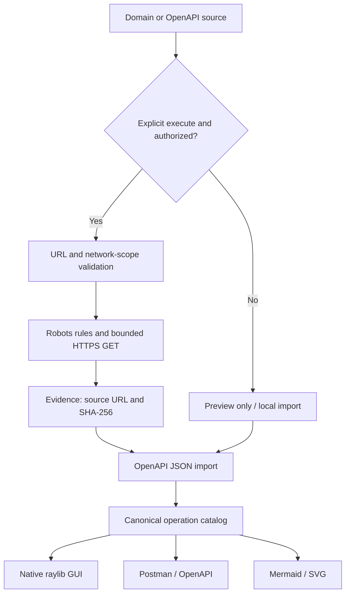

# RESTMORE / Engineering architecture

> **Design rule:** the discovery engine is a portable C11 library. Interfaces and exporters consume structured evidence; they do not invent endpoints.

## System diagram



This diagram depicts the architecture and intended flow. Actual implementation constraints are authoritative in `src/`.

## Component responsibilities

| Component | Primary responsibility | Design boundary |
|---|---|---|
| `core.c` | Normalize input and manage local invariants | No network dispatch |
| `network.c` | Fetch documentation within authorized scope | Only bounded documentation GET |
| `json.c` | Parse JSON and reject invalid structure | Never interpret data as code |
| `catalog.c` | Map documented operations and provenance | Preserve source identity |
| `sha256.c` | Calculate content fingerprints | Fingerprinting, not authentication |
| `exports.c` | Produce interoperable artifacts | Avoid asserting undiscovered metadata |
| `gui.c` | Native exploration interface | No embedded browser runtime |
| `docs/` | Static marketing and sample topology | No live remote scanning |

## Data flow

```text
+--------------------------+      +------------------------+
| rm_target                |      | rm_document            |
| host                     |      | url / content_type     |
| url                      |----->| status / bytes / depth |
+--------------------------+      | sha256                 |
                                  +-------------+----------+
                                                |
                                                v
                                  +------------------------+
                                  | rm_operation           |
                                  | method / path          |
                                  | summary / operation_id |
                                  | source_url             |
                                  | source_sha256          |
                                  +-------------+----------+
                                                |
                              +-----------------+-----------------+
                              |                 |                 |
                              v                 v                 v
                           OpenAPI           Postman          SVG/Mermaid
```

The source URL and content hash belong to each documented operation, enabling an analyst to trace the source material.

## Visual language

The design tokens are specified in `docs/DESIGN.md`; the static site implements them in `docs/style.css`. Native raylib uses corresponding colors and hierarchy. Both should distinguish **observed** evidence, **inferred** relationships, and **sample** presentation data. Sample API operations must never be labeled as an actual scan result.

## Threat model checkpoints

- Public-network checks must account for both IPv4 and IPv6; audit DNS re-resolution and rebinding behavior.
- Disallow credentials, URL userinfo, arbitrary custom ports, redirects and cross-origin hops unless explicitly included in an approved documented scope.
- Cap request count, depth, response sizes, durations and output sizes; never send unsafe HTTP methods while mapping.
- Honor robots guidance conservatively, while requiring affirmative user authorization independent of robots.
- Treat all retrieved documents as hostile input; bounds-check parsers, escape output, and sanitize file paths.
- Run the parser with ASan/UBSan and fuzzed **local input fixtures** before a security-sensitive release.
- Keep the web demo strictly static. It must not fetch a URL provided in its input field.

## Platform matrix

| Platform | C11 core | Native GUI source | Packaging status |
|---|---|---|---|
| Linux | CMake target | raylib target | Validate binaries in CI |
| Windows | CMake target | raylib target | Validate toolchain and runtime |
| macOS | CMake target | raylib target | Validate signing and SDK assumptions |
| Android ARM64 | Native C11 compiled in CI | raylib NativeActivity compiled in CI | Debug APK packaged and signature verified; device runtime pending |
| iOS ARM64 | Native C11 core builds in CI | No verified iOS GUI app target yet | IPA and device testing outstanding |

**Desktop GUI builds and an Android debug APK are now available.** Android runtime verification and iOS app packaging are separate milestones; source portability is not a guarantee of installable, fully tested apps.
