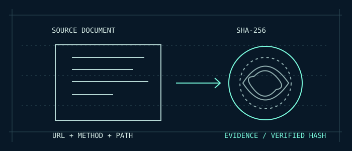

# RESTMORE / Contract Verification

## MAP THE DOCUMENTED. VERIFY THE RESPONSE.

RESTMORE's **Contract Verification** uses an already imported OpenAPI atlas to check a small, fixed set of *documented* HTTP GET responses. It is not fuzzing: no guessed endpoints, no path mutation, no request-body generation, no parameter injection, no credential replay, no POST/PUT/PATCH/DELETE execution.

### 01 / Enter one public domain

In the native C11 GUI, enter a public HTTPS **domain only**, such as `api.your-company.example` (a placeholder; replace it with a real permitted domain). Click **MAP / REVIEW GITHUB**. RESTMORE immediately opens GitHub's repository **search** with that exact domain. GitHub search does **not** prove the repository belongs to the domain. No target API request is issued when MAP is clicked.

If a domain does not have a discoverable or credible GitHub repository, there is no automatically verified GitHub ownership relationship. You must establish the real source and permission yourself. RESTMORE does not fabricate a repo link or assume the first search result is authoritative.

### 02 / Supply the existing atlas

Use **OPEN LOCAL DOCUMENT** to import the API's existing OpenAPI JSON or RESTMORE `library.json`. The API must explicitly declare the requested server host in its OpenAPI `servers` field, or the saved library must retain the corresponding target host. A documentation host or a similarly named GitHub organization is **not** sufficient to bind an API's execution origin.

RESTMORE prepares a **preview** of up to five eligible operations: literal, parameter-free GET paths with explicit success response status 200 or 204. It rejects unsafe-looking paths, template placeholders, query strings, authentication, admin, reset, finance, state-changing operations and any endpoint outside the fixed imported catalog. A source with no eligible responses is not tested.

### 03 / Confirm GitHub review

After reviewing the repository search, return to RESTMORE and deliberately click **I REVIEWED GITHUB & HAVE PERMISSION**. This is a user attestation, **not** identity verification by GitHub or proof that the user owns the server. Changing the domain or the loaded atlas invalidates the pending review.

### 04 / Authorize

Click **AUTHORIZE / N DOCUMENTED GET CHECKS**. This is a separate gesture, enabled only after the GitHub review acknowledgment and atlas-host binding. Both `github_reviewed` and `authorized` are checked again in the C11 engine before it permits traffic.

The network worker first checks `robots.txt`. It fails closed if the policy cannot be established, uses only HTTPS with certificate checks, refuses redirects, bypasses proxy settings, rejects local/private/reserved socket addresses, enforces a minimum two-second gap between GETs and stops on HTTP 429/5xx rather than retrying. Each response is limited to 128 KiB, and there are at most five documented GET checks.

### 05 / Compare and inspect

For eligible 200/204 operations, RESTMORE compares the **exact HTTP status**, **declared content type** when specified, valid JSON syntax for JSON responses and a **shallow root type** (`object`, `array`, etc.) if the OpenAPI source declares one. A matching HTTP status alone is displayed as **STATUS ONLY**, not as full validation.

**This is not a full JSON Schema validator.** It does not prove field-level correctness, response semantics, runtime availability of every endpoint, authentication, or specification completeness. It does not substitute for API integration tests or server-owner verification.

The native Inspector lists checks as **MATCH**, **STATUS ONLY**, **MISMATCH**, **ERROR** or **SKIPPED**. Press **EXPORT VERIFICATION JSON** to write `restmore-verification.json` in the current working directory. The report records the domain, scope acknowledgment, authorization, exact paths, expected and observed status/MIME, source SHA-256 and outcomes. It deliberately omits response bodies, cookies, credentials and request secrets.

### Quality gates

Pure-C planner tests ensure that unsafe paths, non-GET operations, unresolved path parameters and unspecified response contracts are never selected. Network execution is blocked unless the plan is host-bound and both human-review and explicit authorization gates are set. Desktop builds use libcurl; the current Android debug APK is offline, and iOS has no distributable app.

**Authorization has to exist outside the app.** A click records your confirmation, not legal permission conferred by RESTMORE. Use only systems you are permitted to test.

[Native source](../src/verification.c) · [Networking implementation](../src/network.c) · [Regression tests](../tests/test_verification.c) · [Architecture](ARCHITECTURE.md)
