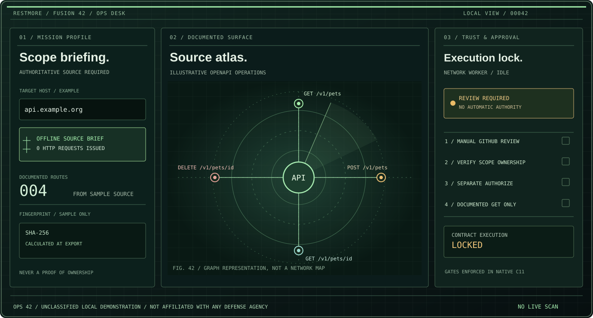

# RESTMORE OPS 42 / Operational Evidence Desk

**MISSION DISCIPLINE. VERIFIED SOURCES. HUMAN AUTHORIZATION.**

> Fictional, unclassified operational design. Not affiliated with E-tjenesten, any military, or any government body. It is not a legal authorization or official classification.

## 01 / Mission profile

OPS 42 combines the existing RESTLESS × RESTMORE C11 engine with an explicitly **offline operational briefing** workflow and a restrained field-console visual identity.

The report is a real machine-readable file generated by the native C11 engine, not a mockup. Export **ops-brief.json** from documentation already imported into the CLI or native GUI, without contacting any target.

It records the declared server host (or explicitly indicates that binding is absent), source document and route counts, method distribution, documented response status per route, source SHA-256 strings when available, and a reproducible SHA-256 atlas fingerprint.

Every output says **mission_state = REVIEW_REQUIRED**, **target_execution = false**, **permission_conferred = false**. It also records that GitHub review and a distinct human authorization are required before the separate native verification worker may run.

The briefing step **never executes network requests**, confers no authority and never includes credentials or response bodies.

## 02 / Operational workflow

1. **Brief.** Import OpenAPI 3 JSON or a previously archived RESTLESS Botanical folder. The Botanical import checks source bytes against SHA-256 hashes before extracting operations.
2. **Inspect.** Review declared operations, sources, method and provenance. Export the offline OPS 42 mission brief.
3. **Attribute.** If authorized API verification is needed, enter a domain and click MAP. The GUI opens GitHub *search*. Repository search is not proof of domain ownership.
4. **Approve.** Independently establish permission. Acknowledge manual GitHub review and separately click **AUTHORIZE**. Both conditions are enforced in C11; a changed target invalidates the plan.
5. **Verify.** Only eligible documented GET operations are checked against status, declared MIME type and JSON root type. No guessed endpoints, mutating requests, authentication bypass or response-body collection.

Documentation crawling has its own separate consent and HTTPS/public-address/robots/scope safeguards.

## 03 / Reproducible CLI

Build the pure C11 engine with no network capability:

    cmake -S . -B build-ops -DRESTMORE_NETWORK=OFF -DRESTMORE_TESTS=ON
    cmake --build build-ops --config Release
    ctest --test-dir build-ops --output-on-failure

From a local OpenAPI JSON file:

    ./build-ops/restmore-cli --import examples/openapi-petstore.json --ops-brief --out evidence

From a verified RESTLESS Botanical archive:

    ./build-ops/restmore-cli --fusion-import .restless/botanical --ops-brief --out evidence

Generated outputs include evidence/library.json and evidence/ops-brief.json. The native C11/raylib inspector also provides **EXPORT OPS 42 MISSION BRIEF**, writing restmore-export/ops-brief.json.

## 04 / Engineering intent

The goal is **source and decision accountability**, not the highest request rate. Distinguish documentation, observed behavior, access permission and evidence integrity. This design demonstrates assumptions and fail-closed tests rather than disguising limitations with dramatic graphics.

The visual system uses a near-black olive background, signal-green method and provenance labels, amber human-approval gates, an architectural grid and an original evidence-console illustration. It avoids fictional vulnerability scores and fake realtime telemetry.

## 05 / Verification and limitations

The [OPS 42 CI workflow](../.github/workflows/ops-42.yml) builds pure C11 on Windows, macOS and Linux, tests offline report reproducibility and denial states, validates HTML/SVG, and exercises the existing isolated HTTPS 200/304, robots, TLS and SHA-256 tamper regression.

An atlas fingerprint is a **checksum, not a digital signature or proof of publisher ownership**. A report records source hash values but does not reread or independently revalidate archive bytes. That byte check belongs to the separate Botanical import and crawler.

This is not an exploitation framework, a full JSON Schema validator, an official E-tjenesten product, a certification or permission to test a third-party system. The current catalog has explicit finite capacity. Mobile physical-device verification and distribution signing remain separate.

[OPS 42 website](ops-42.html) · [Fusion 42 architecture](FUSION-42.md) · [C11 source](../src/ops_brief.c) · [C11 tests](../tests/test_ops.c)
