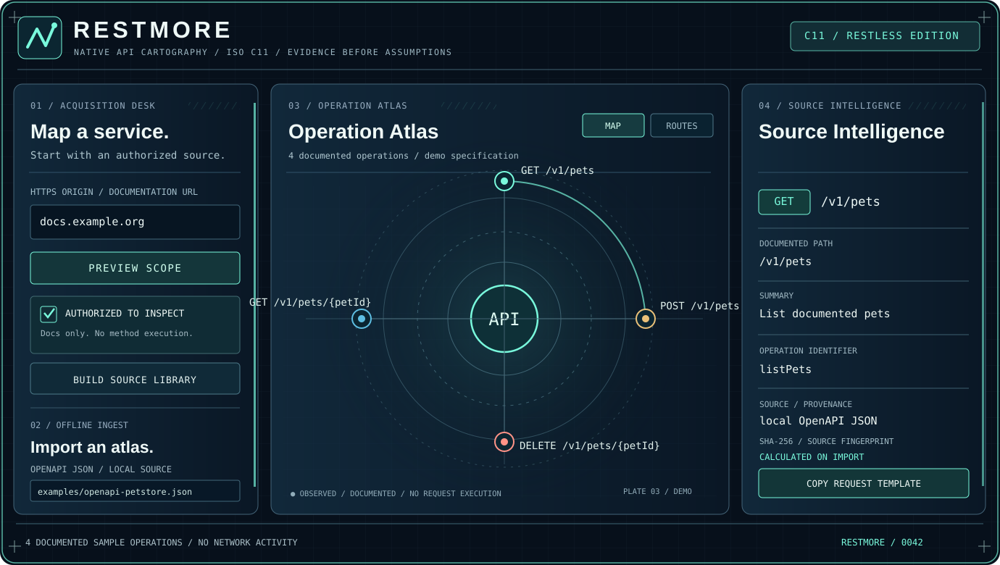
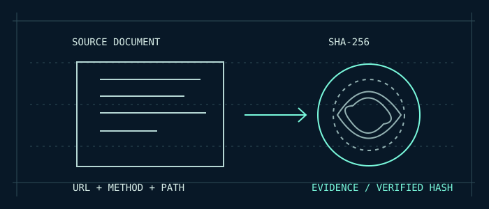

# RESTMORE

## MAP THE UNSEEN.

> **Native API cartography · ISO C11 · Evidence before assumptions**

An API is a territory. Its documentation is the map we have, not necessarily the complete territory. RESTMORE gives that documentation structure, context and a traceable origin.

**RESTMORE is a native documentation atlas**, implemented in C11. Give it an authorized documentation source or local OpenAPI 3 JSON, and it creates an inspectable catalog of **declared paths, HTTP methods and operations**, connected to their source documents and SHA-256 fingerprints.

*Illustrative UI plate. It uses demo operations, not a live scan.*

### 01 / WHAT IT IS

A navigator for documented interfaces. Not a fuzzer. Not a speculative endpoint enumerator. Not a client that automatically calls every operation it discovers.

### 02 / WHY IT MATTERS

Unknown is not the same as undocumented. RESTMORE does not claim an API operation exists just because a path looks plausible. A SHA-256 digest identifies the source bytes, not the publisher's identity or trustworthiness.

### 03 / FOUR INSTRUMENTS

**Acquisition Desk.** Preview a HTTPS scope with zero network requests, then explicitly authorize bounded documentation discovery, or import local OpenAPI JSON.

**Operation Atlas.** Explore a bounded orbital map and scrollable routes list of the operations present in the catalog.

**Source Intelligence.** Inspect methods, summary, operation ID, origin and document fingerprint.

**Evidence Exports.** Save a catalog and supported OpenAPI, Postman, Mermaid and SVG outputs for downstream review.

### 04 / NATIVE BY DESIGN

ISO C11 implementation; CMake builds; raylib GUI; optional libcurl. Windows x64, Linux x86-64 and macOS desktop alpha assets are published. Android ARM64 has an offline debug APK, not yet verified on a physical device. iOS has no installable app. The website uses synthetic sample data and does not perform API crawling.

### 05 / THE CONTRACT

Inspect only sources you are authorized to access. RESTMORE does not execute the API methods it discovers, and its documentation-derived atlas should not be interpreted as a complete inventory of a live service.

**Know what is documented. Know where it came from.**

[Illustrated guide](field-guide.html) · [Release](https://github.com/bspippi1337/restmore/releases/tag/v0.1.0-alpha.5) · [Source](https://github.com/bspippi1337/restmore)
