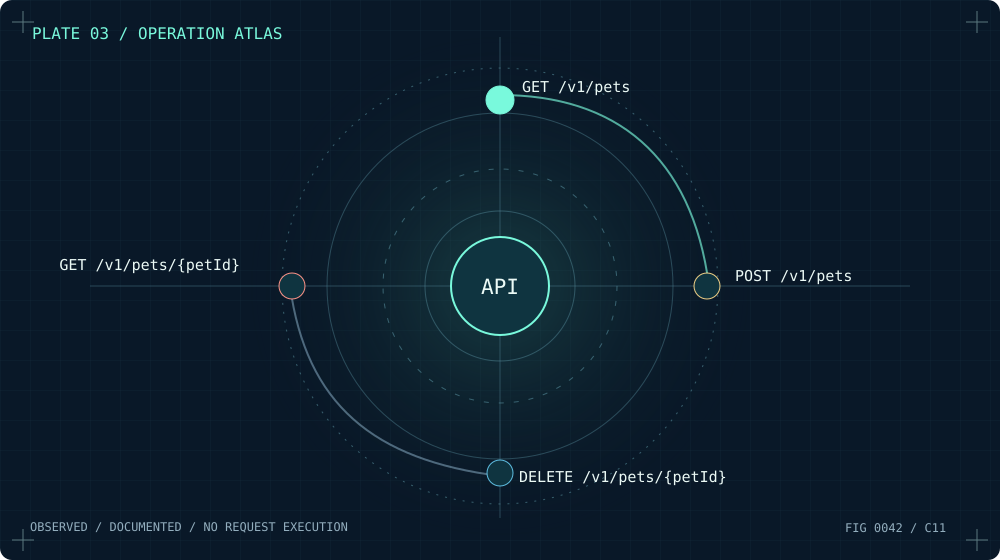
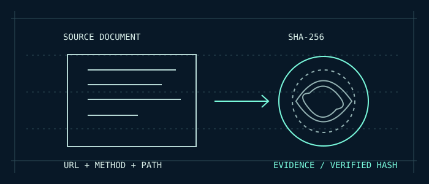

# RESTMORE / Field Guide 0042

### MAP THE UNSEEN.



## 01 / Set the scope

Start from an authorized documentation URL, or the bundled local OpenAPI JSON sample.

```bash
restmore-cli docs.example.org
```

This **previews** a target and makes zero network requests.

## 02 / Authorize inspection

Only when you have permission:

```bash
restmore-cli docs.example.org --execute --authorized --out atlas
```

Both flags are required. RESTMORE fetches documentation only, with bounded depth, request rates and scope. It never executes the API operations it finds.

## 03 / Build the source library

For a reliable, fully offline demonstration:

```bash
restmore-cli --import examples/openapi-petstore.json --out atlas
```

The exported `atlas/library.json` describes documented operations; source hashes identify the exact document bytes.

## 04 / Explore the operation atlas

Run the native GUI, select **MAP** for an orbital overview or **ROUTES** for the list. Select a documented operation to inspect its details.


## 05 / Inspect provenance



Look for the method, operation ID, summary, source URL and SHA-256. A fingerprint proves which bytes were read, not that their publisher is authentic or the documentation complete. Export the atlas for review.

**Important:** Android ARM64 alpha APK is offline and not yet physically device-tested; there is no distributable iOS IPA.

[Read the illustrated HTML guide](field-guide.html) · [Build manual](BUILD.md) · [Product story](PRODUCT.md)

**Current illustrated distribution:** [RESTMORE Alpha 5 / Architectural Edition](https://github.com/bspippi1337/restmore/releases/tag/v0.1.0-alpha.5).
